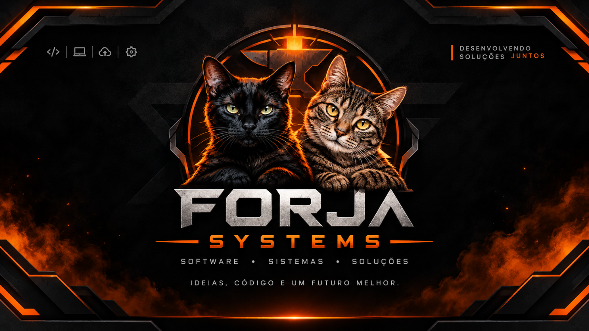

<div align="center">
  
  <h1>Forja Systems · Cardápio Digital</h1>
  <p>Uma demonstração responsiva de catálogo, personalização e sacola de compras.</p>
  <p>
    
    
  </p>
</div>

---

## ✨ Sobre

Este projeto de portfólio da **Forja Systems** mostra como um cardápio digital pode organizar produtos por categoria e funcionar em computadores e celulares.

Todos os nomes, produtos e preços são fictícios. A sacola e a finalização são apenas demonstrações: **nenhum pedido é enviado, nenhum pagamento é processado e nenhum dado pessoal é coletado**.

## 🧩 O que a demonstração inclui

- Catálogo organizado em categorias com navegação rápida.
- Opções e preços para cada produto.
- Sacola interativa com quantidades e total.
- Painel de exemplo para cadastrar, editar e remover produtos.
- Integração opcional com Supabase e função administrativa para Netlify.
- Identidade visual Forja Systems e ilustrações criadas para esta demonstração.

## 🚀 Executar localmente

É necessário ter Python instalado. Na pasta do projeto, execute:

```powershell
python -m http.server 8000
```

Abra [http://localhost:8000](http://localhost:8000) no navegador. O catálogo de demonstração funciona sem configurar banco de dados.

## ☁️ Usar Supabase e Netlify

Para experimentar o painel com um banco próprio:

1. Crie um **projeto Supabase separado para demonstração**.
2. Execute `supabase/migration.sql` no SQL Editor desse projeto.
3. Configure `config.js` com a URL do projeto e uma chave publishable/anon. Essa chave fica visível no navegador; use Row Level Security.
4. No Netlify, configure `SUPABASE_URL`, `SUPABASE_SERVICE_ROLE_KEY`, `ADMIN_SESSION_SECRET`, `ADMIN_USERNAME_1`, `ADMIN_PASSWORD_1` e, se necessário, o segundo usuário.
5. Publique esta pasta no Netlify. A demonstração do painel ficará em `/edicao`.

O painel e as funções administrativas precisam do Netlify; não publique a chave `service_role` ou senhas no navegador, no GitHub ou em arquivos versionados. O arquivo `.env.example` contém apenas exemplos.

## 🔐 Segurança

- A cópia não contém credenciais nem dados de uma loja real.
- A configuração Supabase do navegador começa vazia em `config.js`.
- Nunca use a chave `service_role` no front-end; mantenha-a apenas nas variáveis privadas do Netlify.
- Não versione `.env`, `.netlify`, configurações locais ou credenciais.
- Consulte [`SECURITY.md`](SECURITY.md) antes de configurar uma instância.

## 🗂️ Estrutura

```text
.
├── index.html                 # Catálogo demonstrativo
├── app.js                     # Categorias, produtos e sacola
├── edicao.html                # Painel de exemplo
├── edicao.js                  # Interações do painel
├── styles.css                 # Layout e componentes
├── forja-theme.css            # Tema Forja Systems
├── netlify/functions/admin.js # API administrativa
└── supabase/migration.sql     # Estrutura e catálogo fictício
```

---

<div align="center">
  <strong>Forja Systems</strong><br />
  <sub>Ideias, código e um futuro melhor.</sub>
</div>
